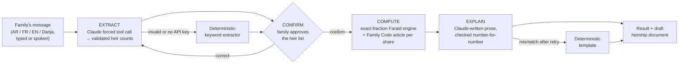

# Mizan · ميزان

**AI-assisted Islamic inheritance (Faraid) calculation and heirship-document drafting for Morocco, in Arabic, French, English and Moroccan Darija.**

[](https://github.com/awsm36z/mizan-web/actions/workflows/ci.yml)


A family describes, in their own words and language, who survives the person who died. Mizan turns that into a structured list of heirs, asks the family to confirm it, computes each heir's exact share under Moroccan family law, explains the result in plain language, and drafts a document the family can take to their Adoul (the licensed notary who issues the official heirship certificate).

The core design principle: **a language model never does the math.** Claude reads and writes language; a deterministic exact-fraction engine computes every share; and every number the model writes is checked against that engine before a user sees it.

---

## Why this exists

Every inheritance in Morocco must be settled under Faraid, the Qur'anic share system codified in the Moudawana (Family Code). About 210,000 people die in Morocco each year, and each estate triggers this calculation. Today it is done by hand by the country's 3,455 licensed Adouls, with no software of record. Families have no independent way to check the result or understand why a share applies, and the 3 to 5 million Moroccans living abroad often learn about missing paperwork only after flying home.

Mizan is built to sit **alongside** the Adoul, not replace them. Only a licensed Adoul can issue an Iratha (heirship certificate), so every document Mizan produces is explicitly a draft for professional review. That framing is a product decision, not just a disclaimer: it is what makes a professional tool for Adoul offices sellable at all.

## How it works



1. **Extract.** Claude is called with a forced tool (`set_heir_draft`) and must return integer counts for each heir type. The result is structurally validated before it is trusted; anything malformed falls back to a deterministic multilingual keyword extractor.
2. **Confirm.** The API refuses to compute until the family explicitly confirms or corrects the extracted heirs. This gate is enforced by the request shape (a 400 if the confirm/correct action is missing), not by parsing free text.
3. **Compute.** A single engine in `lib/engine.ts` computes shares with exact rational arithmetic. It covers fixed Qur'anic shares (fardh), residuary heirs (asaba), proportional scaling when fixed shares exceed the estate ('awl), return of leftover residue (radd), exclusion (hijab), and the el-gharâwyn special case. Every share cites the Family Code article it comes from.
4. **Explain.** Claude writes a short explanation of the already-computed result. Every fraction it mentions must match the engine exactly. One retry is allowed, then it falls back to a deterministic template, so an unvalidated model number is never shown.
5. **Draft.** The family can generate a draft Iratha or Iratha + Fardiya document with locked computed shares, editable fields for the Adoul, witness sections, a status workflow, and print/email/WhatsApp export. It is always labeled as a draft.

## Engineering decisions worth noting

- **LLM for language, code for law.** Inheritance shares are legal outcomes, so they come from deterministic code with golden-value tests. The model only handles the parts that need language understanding.
- **Graceful degradation.** Without an `ANTHROPIC_API_KEY`, or if a call fails, the whole app still works on deterministic paths. It builds, runs and passes its tests with zero external services.
- **Exact arithmetic.** Shares are rational numbers (`Frac`), not floats, so 7/24 stays 7/24 and every result sums to exactly 1.
- **Real multilingual support, including right-to-left.** Four languages with full RTL layout for Arabic and Darija. The extractor handles language-specific grammar, such as the Arabic dual (بنتان, "two daughters" in one word), attached conjunctions (وابن, "and a son"), and Darija's number-before-noun counting.
- **Voice input** through the browser's built-in Web Speech API. No audio leaves the device.
- **Honest scope.** The engine models husband, wife, son, daughter, father, mother and full siblings. It deliberately does not guess outside that set (half-siblings, grandparents, predeceased children and so on), and it says so in the UI.
- **Bugs found and fixed with regression tests.** Examples: a residuary sibling silently disappearing from results after 'awl, a husband-and-wife draft being accepted, and Darija words beginning with و being mangled by conjunction stripping. See [`docs/ENGINEERING_NOTES.md`](docs/ENGINEERING_NOTES.md).

## Product and business

Mizan is designed as a four-product platform, sequenced so each product builds trust and data for the next:

| Product | For | Status |
|---|---|---|
| **Mizan Calculate** | Families: free calculator plus a paid draft document | This repository |
| **Mizan Pro** | Adoul offices: structured drafting, article citations, audit trail | Waitlist |
| **Mizan Family** | Moroccans abroad managing an estate remotely | Waitlist |
| **Mizan Verify** | Banks and insurers verifying heirship before releasing assets | Later |

The go-to-market plan starts with consumers (low acquisition cost, builds trust), then sells to Adoul offices (highest willingness to pay), then expands to the diaspora and institutions. The in-app waitlists collect interest for the next two products.

## Tech stack

Next.js 14 (App Router) · React 18 · TypeScript · Anthropic Claude API (forced tool use, validated generation) · Vitest · GitHub Actions

## Run it locally

```bash
npm install
npm run dev        # http://localhost:3000
npm test           # engine + extraction test suites
npm run build
```

Optional environment variables:

| Variable | Purpose |
|---|---|
| `ANTHROPIC_API_KEY` | Enables Claude for extraction and explanations. Without it, the deterministic paths are used. |
| `ANTHROPIC_MODEL` | Overrides the model (default `claude-opus-5`). |

The test suite covers the deterministic paths. The Claude paths are validated at runtime as described above.

## Project structure

```
app/api/chat/turn/route.ts   collecting → awaiting_confirmation → computed state machine
app/api/waitlist/route.ts    waitlist capture for Mizan Pro / Mizan Family
lib/engine.ts                the Faraid engine (exact fractions, 'awl, radd, special cases)
lib/llm.ts                   Claude extraction + validated explanation, with fallbacks
lib/extract.ts               deterministic extractor for all four languages
lib/explain.ts               deterministic explanation templates
lib/i18n.ts                  EN / FR / AR / Darija copy, labels, citations
components/                  chat UI, confirmation and result cards, document drafter
tests/                       golden-value engine tests, extraction tests
```

## Disclaimer

Mizan produces estimates and drafts for planning. It is not, and does not replace, an Iratha certificate issued by a licensed Adoul. For any legally binding determination of heirs, consult a licensed Moroccan Adoul or family-law attorney.

---

## About the author

Built by **Yassine El Yacoubi**, a full-stack engineer and founder who builds applied AI products end to end: product strategy and legal framing, LLM pipelines, and production TypeScript.

- Previously: Software Engineering Intern on Amazon's DynamoDB performance team
- Also built: [Vitali AI](https://github.com/awsm36z/telehealth-ai-mvp) (AI telehealth intake with an LLM eval suite), [museAIm](https://github.com/awsm36z/museAIm) (conversational AI guide for Pacific Science Center), and [Sakina Wilderness](https://sakinawilderness.org) (production Next.js + Stripe + Supabase platform)
- Writing: [My AI Triage Bot Missed Every Emergency. Here's How Evals Caught It.](https://medium.com/@yassine.elyacoub/my-ai-triage-bot-missed-every-emergency-heres-how-evals-caught-it-e3b547b6db7b)
- [LinkedIn](https://linkedin.com/in/yassine-el-yacoubi) · [X](https://x.com/YassineElYacou)
